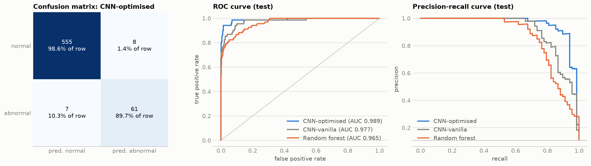
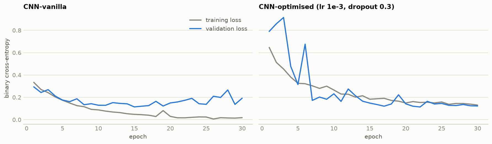
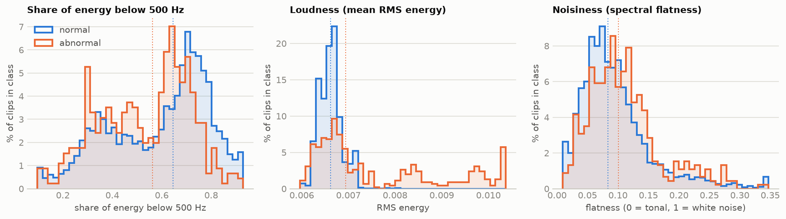
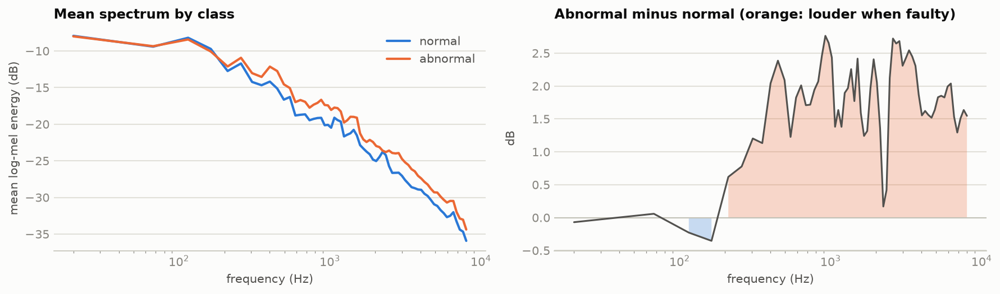
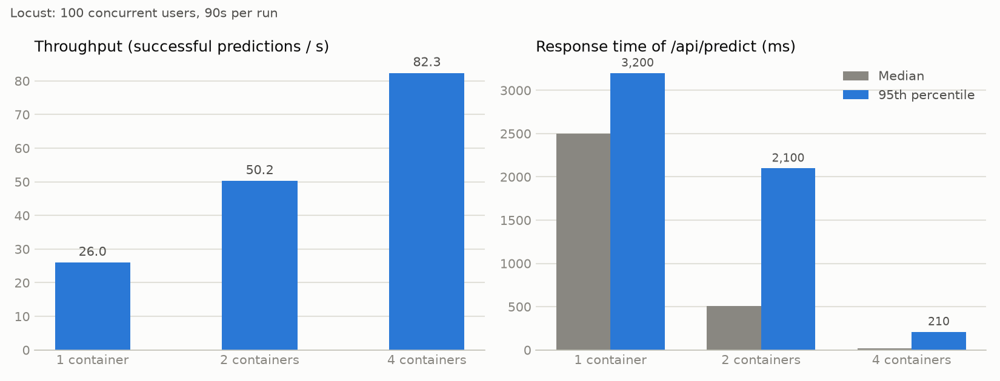

# PumpSense: water-pump fault detection from sound

An end-to-end machine learning pipeline that listens to a **10-second recording of a water pump** and says whether
it sounds **normal** or **abnormal** (likely faulty). It is deployed as a web app with uptime monitoring, data
insights, single-file prediction, bulk upload of new labelled audio, and retraining on demand or automatically.

| | |
|---|---|
| **Live app** | _TODO: https://&lt;hf-username&gt;-pumpsense.hf.space_ |
| **API docs (Swagger)** | _TODO: https://&lt;hf-username&gt;-pumpsense.hf.space/docs_ |
| **Video demo** | _TODO: YouTube link_ |
| **Notebook** | [`notebook/pump_sound_fault_detection.ipynb`](notebook/pump_sound_fault_detection.ipynb) |
| **Model files** | [`models/pump_sound_cnn.keras`](models/pump_sound_cnn.keras) and [`models/pump_sound_cnn.h5`](models/pump_sound_cnn.h5) |

## 1. Project description

**Problem.** My Intro to ML summative predicted the status of rural water points in Tanzania from tabular records.
Its hardest class was *functional needs repair*: on paper, a pump that is starting to fail looks like a healthy one.
A failing pump often **sounds** different well before it stops, because leaks, clogging and worn parts change its
noise. This project extends that use case to audio. A technician, or a cheap microphone on site, records the pump,
and the model flags recordings that sound abnormal so that inspections go where they are needed.

**Data.** I used the [DCASE 2020 Challenge Task 2 development set, *pump*](https://zenodo.org/records/3678171)
(MIMII dataset, CC BY 4.0). It holds 4,205 ten-second, 16 kHz recordings of four industrial water pumps with real
factory background noise: 3,749 normal and 456 abnormal (10.8 %). The abnormal clips were recorded while faults
such as leakage, contamination and clogging were introduced. I pooled the original folders and made a stratified
split by class and pump with `scripts/download_data.py`:

| Split | Normal | Abnormal | Used for |
|---|---|---|---|
| `data/train/` | 2,810 | 343 | training (15 % of it is the validation set) |
| `data/test/` | 563 | 68 | held-out test set; also used to evaluate every retrained model in production |
| `data/new_batch/` | 376 | 45 | "new field recordings", never used for training in the notebook; uploaded through the app to demonstrate retraining |

**Model.** The classifier is a compact CNN (163,666 parameters) on 64-band log-mel spectrograms. Per-band
normalisation is a layer inside the model, so the scaler is saved with it. Optimisation: BatchNorm, Dropout, L2
weight decay, SpecAugment-style augmentation, class weights for the 1:8 imbalance, Adam, early stopping with best
weights restored, learning-rate decay, a small grid search over learning rate and dropout, and a decision threshold
tuned on the validation set.

## 2. Results

### Model evaluation on the held-out test set (631 clips, used once)

| Model | Accuracy | Loss | Precision | Recall | F1 | ROC-AUC | PR-AUC |
|---|---|---|---|---|---|---|---|
| **CNN, optimised (deployed as v1)** | **0.976** | **0.075** | 0.884 | **0.897** | **0.891** | **0.989** | **0.959** |
| CNN, vanilla (no regularisation or early stopping) | 0.962 | 0.145 | 0.867 | 0.765 | 0.812 | 0.977 | 0.909 |
| Random forest on handcrafted features | 0.948 | 0.139 | 0.973 | 0.529 | 0.686 | 0.965 | 0.864 |
| Logistic regression on handcrafted features | 0.835 | 0.402 | 0.366 | 0.721 | 0.485 | 0.900 | 0.716 |

Precision, recall and F1 are for the *abnormal* class. The deployed model **catches 61 of 68 faulty recordings and
raises 8 false alarms out of 563 healthy ones** (specificity 0.986). The random forest is more precise but misses
almost half of the faults. All experiments, with validation metrics and settings, are in
[`reports/experiments.csv`](reports/experiments.csv).



The vanilla CNN overfits: its validation loss bottoms out at epoch 15 and then climbs while training loss keeps
falling. The regularised model's validation loss follows its training loss:



### What the data says (three feature stories)



1. **Where the energy sits (share of energy below 500 Hz).** A healthy pump is dominated by its low hum: 65 % of its
   energy is below 500 Hz. For abnormal clips this falls to 56 %, and the shift appears in **all four pumps**. Leaks
   and clogging add turbulence and rattle *above* the hum. The average spectrum shows the same thing: below 300 Hz
   the classes are within 0.4 dB, while from 300 Hz to 8 kHz abnormal pumps are about 2 dB louder.
2. **Loudness (mean RMS energy).** Faulty pumps are slightly louder (median +5 %). On its own this is the best
   single feature (ROC-AUC 0.71), but most of the effect comes from one pump (id_00, +28 %), and pump id_04's faulty
   clips are not louder at all.
3. **Noisiness (spectral flatness).** Faulty pumps sound noisier (0.100 vs 0.083), but the classes overlap heavily.
   Pump id_04's *healthy* sound is noisier than other pumps' faulty sound.

**The story:** every pump has its own "normal", so no fixed threshold on any single feature works. This is why
the model is a CNN that learns patterns across 64 frequency bands and 10 s of audio. It reaches ROC-AUC 0.989,
against 0.71 for the best single feature.



### Retraining

Retraining loads the current production model as the pre-trained starting point and fine-tunes it on the uploaded
data plus a replay buffer of original training clips. In the Docker container (1 CPU), I uploaded
`data/retrain_demo_batch.zip` (60 clips) and pressed **Retrain**. The run took 43 s and promoted **v2**: test
PR-AUC went from 0.959 to 0.968 and F1 from 0.891 to 0.913. Results vary a little from run to run, and the
promotion gate (below) decides whether a candidate goes live.

## 3. How the app works

```
                   ┌────────────────────────── Web dashboard (ui/) ──────────────────────────┐
                   │  Monitor │ Predict │ Insights │ Upload & retrain        (+ Swagger /docs) │
                   └───────────────────────────────┬──────────────────────────────────────────┘
                                                   │ HTTP (FastAPI, api/main.py)
     ┌──────────────────┬──────────────────────────┼─────────────────────────┬───────────────────────┐
     │ POST /api/predict│ POST /api/upload         │ POST /api/retrain       │ /health, /api/stats   │
     ▼                  ▼                          ▼                         ▼                       │
 prediction.py     retrain.ingest_files       retrain.run_retraining    request counters,        │
  decode, window,    → SQLite (audio BLOB)     1 preprocess uploads       prediction log (SQLite) │
  log-mel, CNN,      → preprocess_pending      2 load current model ◄── models/registry.json ◄────┘
  average windows    → score live model         3 fine-tune: new + replay data
     ▲               → check auto-triggers ──► 4 evaluate old vs new on the test set
     │                                          5 promote if not worse → new version in registry
     └── hot-reloads the model when registry.json changes (all containers share the models volume)
```

* **Prediction.** Upload one recording (WAV, FLAC, OGG or MP3). It is decoded, resampled to 16 kHz, validated, cut
  into 10 s windows (shorter clips are looped) and turned into a log-mel spectrogram. Each window is scored and the
  probabilities are averaged. The page shows the verdict, the probability against the threshold, the latency and
  the spectrogram the model saw. The built-in demo clips are held-out test files whose true label is in the file
  name, so the page also shows whether the prediction is correct.
* **Upload data.** Select many `.wav` files or a `.zip`. Labels come from `normal/` and `abnormal/` folders, from a
  `normal_*`, `abnormal_*` or `anomaly_*` file-name prefix, or from a label chosen for the whole batch. Each file is
  **saved in the SQLite database** as raw audio, with a SHA-256 hash so duplicates are rejected. It is then
  **preprocessed** immediately: invalid, silent or too-short files are rejected with a reason, and the log-mel
  features are stored back in the database. Finally, the live model is scored on the new batch as a monitoring
  check.
* **Retraining.** Press **Retrain now**, or let the automatic trigger fire. The job loads the **current production
  model as the pre-trained starting point** and fine-tunes it with a 5x smaller learning rate on all uploaded data
  plus a replay buffer of 1,200 original training clips, so it does not forget what it learned. The new threshold
  is tuned on a validation split re-weighted to the real 11 % share of faults. Old and new models are then evaluated
  on the same held-out test set. The new version is **promoted only if its PR-AUC does not drop by more than 0.005
  and its F1 by no more than 0.03**. Every version stays in the registry and can be re-activated (rolled back) from
  the Monitor tab.
* **Retraining triggers.** Retraining can be started manually: the button, `POST /api/retrain`, or
  `python -m src.retrain`. After every upload, automatic triggers are also checked: (a) enough new labelled samples
  are waiting (default 100), or (b) the live model's F1 on the new batch is below a floor (default 0.80), a sign of
  drift. Both settings are editable in the UI.
* **Monitoring.** The Monitor tab shows uptime, health-check history, request counts and latency per container,
  every prediction logged in the database, the live model's test metrics and confusion matrix, a button to re-run
  the production evaluation on the test set, and a before/after chart of the latest retrain.
* **Insights.** Class balance per pump, the average frequency profile of normal and abnormal pumps, the three
  interpreted feature distributions, and how well each feature separates the classes on its own.

### API

| Method | Path | Purpose |
|---|---|---|
| GET | `/health` | liveness, uptime, container name, model version |
| POST | `/api/predict` | classify one recording (`file` form field; `?spectrogram=true` adds the image) |
| POST | `/api/upload` | bulk upload (`files` form field, repeatable; `label` = `auto`, `normal` or `abnormal`) |
| POST | `/api/retrain` | start retraining in the background (409 if a run is in progress or there is no new data) |
| GET | `/api/retrain/status`, `/api/retrain/history` | progress and past runs |
| GET, PUT | `/api/settings` | automatic trigger settings |
| GET | `/api/model` | live version, metrics, all versions |
| POST | `/api/model/evaluate` | evaluate the live model on the held-out test set |
| POST | `/api/model/{version}/activate` | roll back or forward |
| GET | `/api/stats`, `/api/insights`, `/api/samples`, `/api/uploads`, `/api/demo-batch` | dashboard data and demo files |

```bash
curl -F "file=@data/samples/abnormal_id_02_b00000003.wav" http://localhost:8000/api/predict
curl -F "files=@data/retrain_demo_batch.zip" -F "label=auto" http://localhost:8000/api/upload
curl -X POST http://localhost:8000/api/retrain
```

## 4. Flood request simulation (Locust)

[`locust/locustfile.py`](locust/locustfile.py) simulates field technicians. Each user sends a 10 s recording to
`/api/predict` roughly once a second (wait 0.5 to 1.5 s), with occasional `/health` checks.
[`locust/run_load_tests.py`](locust/run_load_tests.py) runs the same load, **100 concurrent users for 90 s**,
against 1, 2 and 4 API containers. The containers run behind an nginx round-robin load balancer
(`docker-compose.yml`), and each is limited to 1 CPU.

| Setup | Requests | Failures | Throughput (req/s) | Avg (ms) | Median (ms) | p95 (ms) | p99 (ms) | Max (ms) |
|---|---|---|---|---|---|---|---|---|
| 1 container | 2,294 | 0 (0.0%) | 26.0 | 2,476 | 2,500 | 3,200 | 3,700 | 3,970 |
| 2 containers | 4,482 | 0 (0.0%) | 50.25 | 783 | 510 | 2,100 | 2,500 | 2,913 |
| 4 containers | 7,345 | 0 (0.0%) | 82.35 | 57 | 21 | 210 | 840 | 1,343 |



**Interpretation.** One prediction takes about 20 ms of CPU, so a single 1-CPU container saturates at about 26
predictions per second. The 100 users offer more than that, so requests queue and the median response time grows
to 2.5 s. Doubling to 2 containers doubles throughput (50 req/s) and cuts the median to 0.5 s, but the system is
still saturated. With 4 containers, capacity exceeds the offered load: throughput rises to 82 req/s (close to the
rate at which 100 users with a 1 s think time send predictions) and the median falls to **21 ms**, about the cost
of one prediction. No request failed in any
run. Throughput scales almost linearly with containers, because predictions are stateless and every replica
serves the same model from the shared volume. Full Locust reports (HTML and CSV) are in
[`locust/results/raw/`](locust/results/raw/).

## 5. Setting it up

### Run locally (Python)

Requires Python 3.11; TensorFlow 2.21 does not support Python 3.13 or later yet.

```bash
git clone https://github.com/NickSingizwa/summative-ml-pipeline.git
cd summative-ml-pipeline
python3.11 -m venv .venv && source .venv/bin/activate
pip install -r requirements-dev.txt

uvicorn api.main:app --port 8000          # the trained model and demo files are in the repo
# open http://localhost:8000 (dashboard) and http://localhost:8000/docs (Swagger)
```

To reproduce the data split and training from scratch (a 1 GB download, then about 10 minutes on a laptop CPU):

```bash
python scripts/download_data.py                       # data acquisition + train/test/new_batch split
jupyter nbconvert --to notebook --execute --inplace notebook/pump_sound_fault_detection.ipynb
```

To retrain from the command line instead of the UI:

```bash
python -m src.retrain --ingest data/new_batch         # store + preprocess a folder, then retrain
```

### Run with Docker

```bash
docker build -t pumpsense-api .
docker run -p 7860:7860 pumpsense-api                 # http://localhost:7860

# several containers behind an nginx load balancer (http://localhost:8080)
docker compose up -d --build --scale api=4
docker compose restart lb                              # pick up the new replicas
```

### Deploy to Azure Container Apps

```bash
brew install azure-cli        # or see https://aka.ms/installazurecli
az login
bash scripts/deploy_azure.sh
```

The script creates a resource group, a container registry and a Container Apps environment. It builds the image
in Azure from the `Dockerfile`, so only the source code is uploaded, and runs it with 1 CPU and 2 GB RAM. It prints
the public URL at the end. Running it again rebuilds the image and updates the app.

The cloud app runs as a single replica because the SQLite database and retrained models live inside the container.
Uploaded data and retrained versions reset when the container restarts; the shipped model `v1` is always there.
To stop paying for it after grading: `az group delete -n pumpsense-rg`.

### Reproduce the load test

```bash
docker compose up -d --build
python locust/run_load_tests.py --containers 1 2 4 --users 100 --duration 90s
# or interactively: locust -f locust/locustfile.py --host http://localhost:8080
```

## 6. Demo walkthrough (what the video shows)

1. **Monitor tab:** the app is online, with uptime, model `v1`, its test metrics and its confusion matrix.
2. **Predict tab:** pick the clip `abnormal_id_02_b00000003` (or upload it from `data/samples/`) and press
   **Predict**. The result is *Abnormal: likely fault*, and the true label matches. Repeat with a normal clip.
3. **Insights tab:** the three feature stories and the frequency profile.
4. **Upload & retrain tab:** upload `data/retrain_demo_batch.zip` (or download it from the link on the page). For
   more data, select all files in `data/new_batch/normal/` and then in `data/new_batch/abnormal/`. The files are
   saved to the database and preprocessed, and the live model is scored on them. Press **Retrain now** and watch
   the stages. The before/after chart appears and, if the candidate is promoted, `v2` goes live.
   With the automatic trigger on, uploading 100 or more new clips starts retraining on its own.
5. **Monitor tab:** `v2` is now serving, and new predictions report `model v2`. The previous version can be
   re-activated with one click.

## 7. Repository structure

```
summative-ml-pipeline/
├── README.md
├── notebook/
│   └── pump_sound_fault_detection.ipynb    # acquisition, EDA, preprocessing, training, evaluation, retraining
├── src/
│   ├── config.py                           # paths and audio/training parameters
│   ├── preprocessing.py                    # decode, validate, window, log-mel, handcrafted features
│   ├── model.py                            # CNN, training, fine-tuning, evaluation, persistence
│   ├── prediction.py                       # Predictor with registry hot-reload
│   ├── retrain.py                          # upload ingestion, preprocessing, triggers, retrain job, CLI
│   ├── database.py                         # SQLite: uploads (audio BLOBs), runs, predictions, settings
│   └── registry.py                         # model versions, promotion, rollback
├── api/main.py                             # FastAPI service
├── ui/                                     # dashboard (HTML/CSS/JS, Chart.js)
├── data/
│   ├── train/  test/  new_batch/           # created by scripts/download_data.py (not committed, 1.3 GB)
│   ├── manifest.csv                        # every clip with its split, label and pump
│   ├── processed/                          # test + replay log-mel tensors, insights.json
│   ├── samples/                            # held-out demo clips for prediction
│   └── retrain_demo_batch.zip              # 60 labelled clips from new_batch for the upload/retrain demo
├── models/
│   ├── pump_sound_cnn.keras                # production model v1 (Keras format)
│   ├── pump_sound_cnn.h5                   # same model in HDF5
│   └── registry.json                       # versions, thresholds, metrics
├── reports/                                # experiment table, test metrics, figures
├── locust/                                 # locustfile, experiment runner, results
├── scripts/                                # download_data.py, deploy_azure.sh
├── Dockerfile  docker-compose.yml  deploy/nginx.conf
└── requirements.txt  requirements-dev.txt
```

## 8. Credits

* Data: Y. Koizumi et al., *Description and Discussion on DCASE2020 Challenge Task2: Unsupervised Anomalous Sound
  Detection for Machine Condition Monitoring* (2020); H. Purohit et al., *MIMII Dataset: Sound Dataset for
  Malfunctioning Industrial Machine Investigation and Inspection* (2019). CC BY 4.0.
* Built with TensorFlow/Keras, librosa, scikit-learn, FastAPI, Chart.js and Locust.
